<!-- mkrol-io/mkrol-io · profile README -->
<!-- no cookies · no trackers · no javascript. every image is a file in this repository. -->

<picture>
  <source media="(prefers-color-scheme: dark)" srcset="https://raw.githubusercontent.com/mkrol-io/mkrol-io/master/assets/banner-wide-dark.svg">
  
</picture>

<picture>
  <source media="(prefers-color-scheme: dark)" srcset="https://raw.githubusercontent.com/mkrol-io/mkrol-io/master/assets/terminal-wide-dark.svg">
  
</picture>

<samp><a href="https://mkrol.io">mkrol.io</a> · <a href="mailto:me@mkrol.io">me@mkrol.io</a> · <a href="https://instagram.com/mkrol.io">instagram</a> · <a href="https://x.com/mkrol_io">x</a></samp>

